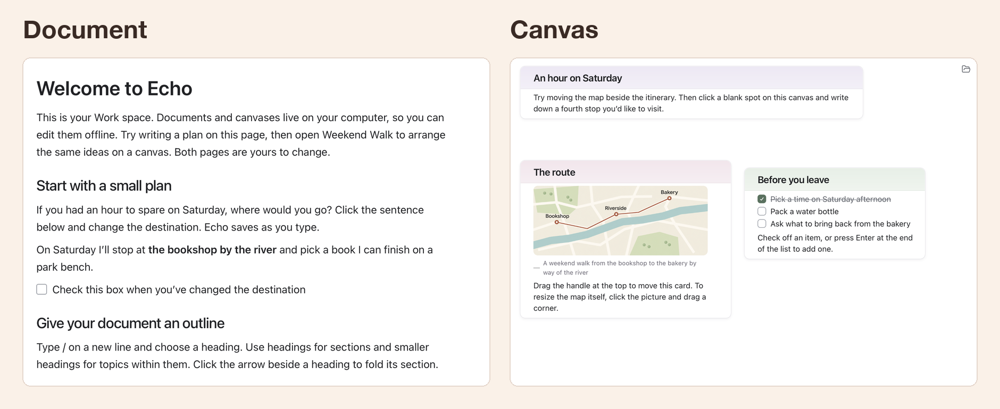

<p align="center">
  
</p>

<h1 align="center">Echo</h1>

<p align="center">
  <b>离线优先的原生桌面笔记，把长文和自由画布放进同一个空间。</b><br>
  用 Rust + Rune 原生绘制：实时排版的结构化文档、自由排布的卡片画布，所有内容以 Markdown 保存在你的电脑上。
</p>

<p align="center">
  
  
  
</p>

<p align="center"><a href="https://github.com/JOYCEQL/Echo/releases/download/v0.0.2/Echo-0.0.2-macos-arm64.zip"></a>&nbsp;&nbsp;&nbsp;<a href="https://github.com/JOYCEQL/Echo/releases/download/v0.0.2/Echo-0.0.2-windows-x64-setup.exe"></a></p>

<p align="center">
  <a href="#安装说明"><b>下载</b></a> ·
  <a href="#为什么是-echo">特性</a> ·
  <a href="#快速上手">快速上手</a> ·
  <a href="#从源码运行">从源码运行</a> ·
  <a href="./docs/guide.md">使用与备份指南</a>
</p>

<p align="center">
  
</p>

> [!NOTE]
> 从 [GitHub Releases][releases] 下载适合系统的安装包。首次安装后，可以在「设置 → 软件更新」中检查并下载新版。

## 为什么是 Echo

**📁 笔记就放在你自己的电脑上。** 没有账号，没有云端，断网也能完整使用。文档正文和画布内容都是开放可读的 Markdown（画布另以同名 `.canvas.json` 保存卡片位置和尺寸），导入的图片原样保存在本地目录。你可以随时拖入 `.md` 导入、单篇导出或整目录备份，没有平台锁定。

**⚡ 原生绘制，轻快省内存。** 整个界面由 Rust 和 [Rune](https://github.com/anomalyco/rune) 直接调用系统图形后端原生渲染（macOS 使用 Metal，Windows 使用 DX12 / Vulkan），不是 Electron，也不是网页套壳。笔记图片按需加载，长文和大图画布都保持顺滑与低内存占用。

**✍️ 长文和自由画布，放进同一个空间。** 同一空间下可混放结构化文档与自由画布，共用页面树、全局搜索与回收站。敲下 `#`、`-`、`- [ ]` 或 `>` 即时排版，输入 `/` 按中英文或拼音插入表格、代码块、Mermaid 图表与 LaTeX 公式；长文自动生成右侧大纲、图片可拖拽角点等比缩放与对齐；画布卡片支持自由拖拽、混排与「一键铺平」。

## 快速上手

1. **打开内置示例**：首次启动后，「工作」空间自带《欢迎使用 Echo · 结构化入门》和《周末散步 · 自由画布入门》，可直接改字、勾选待办或拖拽卡片。
2. **新建你的第一页**：点击「新建页面」（`⌘ N` / `Ctrl + N`）选择文档或画布，输入 `/` 探索全部内容块。
3. **导入与备份笔记**：直接把 `.md` 文件拖入窗口，或点击文件夹图标导入；备份整库时，在「设置 → 本地数据」中打开目录，退出 Echo 后整目录复制即可。

更多快捷键、目录结构与旧版 SQLite 迁移步骤，请参阅 [**使用与备份指南**](./docs/guide.md)。

## 安装说明

- **macOS**：支持 macOS 13 或更新版本（Apple Silicon），解压 ZIP 后将 `Echo.app` 移入「应用程序」。
- **Windows**：支持 Windows 10 (1809+) / Windows 11（x64，显卡驱动需支持 DX12 或 Vulkan），运行 `.exe` 安装程序即可。
- **应用内更新**：安装发行版后默认自动检查新版本，发现新版时侧栏会出现下载按钮；点击下载并校验完成后，再确认重启升级。可在「设置 → 软件更新」手动检查或关闭自动检查。

### 首次安装的系统安全提示

当前 macOS 包仅使用 ad-hoc 签名，尚未经过 Apple 公证，首次打开从网上下载的应用时可能被 Gatekeeper 拦截；Windows 包尚未使用 Authenticode 签名，可能出现 SmartScreen「Windows 已保护你的电脑」提示。

请先确认安装包来自本项目的正式发布渠道，再按对应系统的步骤操作。

**macOS**

1. 将 `Echo.app` 移入「应用程序」，尝试打开一次；若被系统拦截，关闭提示。
2. 打开「系统设置 → 隐私与安全性」，向下找到有关 Echo 被阻止打开的提示，点击「仍要打开」。
3. 按系统提示验证身份并确认打开。按钮名称可能随系统版本略有不同，详见 [Apple 官方说明](https://support.apple.com/zh-cn/102445)。

也可以在确认安装包来源可信后，打开「终端」，针对已移入「应用程序」的 Echo 执行：

```sh
xattr -dr com.apple.quarantine "/Applications/Echo.app"
open "/Applications/Echo.app"
```

这会移除 Echo 及其内部文件的下载隔离属性，然后打开应用；如果安装位置不同，请替换为实际路径。该方式仅处理下载隔离属性，不修复安装包损坏或无效签名。关于隔离属性，参见 [Apple 开发者技术支持说明](https://developer.apple.com/forums/thread/813858)。

如果执行 `xattr` 时提示权限不足（`Permission denied`），可改用以下命令，并按提示输入 Mac 管理员账户的登录密码（输入时终端不会显示字符）：

```sh
sudo xattr -dr com.apple.quarantine "/Applications/Echo.app"
open "/Applications/Echo.app"
```

**Windows**

1. 运行下载的安装程序；如果出现 SmartScreen 提示，点击「更多信息」。
2. 确认文件是你下载的 Echo 安装程序后，点击「仍要运行」，继续安装。
3. 如果没有「仍要运行」选项，设备的管理策略或 Windows 的智能应用控制可能禁止运行，请联系设备管理员；详见 [Microsoft 官方说明](https://learn.microsoft.com/windows/apps/package-and-deploy/smartscreen-reputation)。

以上操作无需关闭 Gatekeeper、SmartScreen 或杀毒软件。应用内更新使用的 Minisign 校验不替代系统代码签名或 Apple 公证。

## 从源码运行

Echo 使用 Rust 和 [Rune](https://github.com/anomalyco/rune) 构建，通过 [`rust-toolchain.toml`](./rust-toolchain.toml) 固定工具链。安装 [rustup](https://rustup.rs/) 及平台依赖（macOS 需 Xcode 命令行工具，Windows 需 Visual Studio Build Tools 的「使用 C++ 的桌面开发」与 Windows SDK）后运行：

```sh
cargo run --locked
```

运行测试使用 `cargo test --locked`。

发版时，在 GitHub Actions 中运行 **Prepare release**（分支选择 `main`），默认自动递增补丁号，例如 `0.0.1 → 0.0.2`，同步各平台版本和下载链接，并提交、创建版本 tag。Mac 与 Windows 使用同一个 tag 打包。详见[自动递增发版版本](./packaging/UPDATES.md#自动递增发版版本)。

## 开源协议

Copyright (C) 2026 Echo contributors.

Echo 的原创代码采用 **GNU Affero General Public License v3.0（AGPL-3.0-only）**，完整条款见 [LICENSE](./LICENSE)。

- **允许商用**：可以使用、修改和销售 Echo，但须遵守协议。
- **分发时提供源码**：分发 Echo 或基于 Echo 的衍生版本时，须按协议提供相应版本的完整对应源码，保留版权与许可声明，衍生作品须按 AGPL-3.0 授权。
- **修改版用于网络服务时提供源码**：如果修改后的版本支持用户通过网络交互，须向这些用户醒目地提供免费获取该版本完整对应源码的途径。

这些义务针对协议覆盖的程序及衍生作品。单纯使用 Echo 写作、商用或推广，不要求公开用户笔记或无关项目的源码。以上为说明摘要，具体权利与义务以协议全文为准。

第三方代码、字体、图标及素材保留各自的许可与权利声明，详见 [THIRD_PARTY.md](./THIRD_PARTY.md) 和 [licenses](./licenses/)。

---

<p align="center">
  <a href="./docs/guide.md">使用与备份指南</a> ·
  <a href="./packaging/UPDATES.md">打包与应用内更新</a> ·
  <a href="./THIRD_PARTY.md">第三方组件说明</a> ·
  <a href="https://github.com/JOYCEQL/Echo/releases">历史版本</a>
</p>

<!-- 发布维护：迁移时统一替换顶部下载按钮与下方的发布仓库地址。Prepare release 自动同步下载链接中的 tag 和附件版本；发布前确认对应安装包已上传。 -->
[releases]: https://github.com/JOYCEQL/Echo/releases
